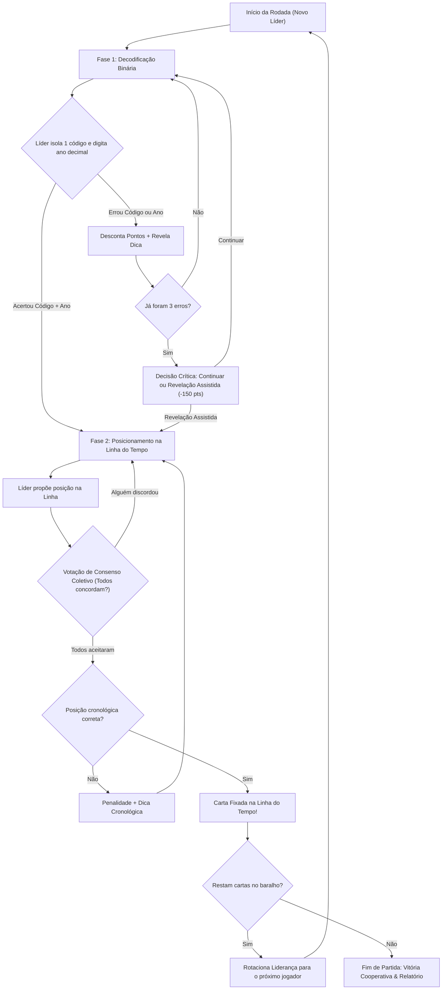

# 🎮 História em Bits — Manual Completo de Regras e Funcionamento

> **Componentes Curriculares:** História & Pensamento Computacional (Lógica Binária)  
> **Público-Alvo:** 1º ano do Ensino Médio (15 a 16 anos)  
> **Habilidades BNCC:** `EM13CHS103` (Argumentação histórica e cronologia) e `EM13CO13` (Representação digital de dados e sistema binário)  
> **Tema Base:** Era das Revoluções (Séculos XVIII e XIX)  
> **Autoras do Design Pedagógico:** Andresa Fernandes, Fernanda Abreu, Pâmela Amorim  

---

## 1. Visão Geral do Jogo

O **História em Bits** é um jogo cooperativo pedagógico em que os participantes assumem o papel de uma equipe de investigação histórica e digital. O objetivo central é **reconstruir a Linha do Tempo da Era das Revoluções**, decodificando anos históricos representados na linguagem fundamental dos computadores: o **código binário**.

Para vencer, a equipe não pode depender de adivinhações individuais: o jogo exige **trabalho em equipe**, **cálculos matemáticos conjuntos** e **debate cronológico fundamentado**.

---

## 2. Modos de Jogo

### 2.1. Multiplayer em Rede Local (Wi-Fi / Hotspot)
* **Jogadores por sala:** 2 a 5 participantes.
* **Capacidade simultânea do servidor:** Até 5 salas ativas (`SALA-01` a `SALA-05`).
* **Como funciona:** 
  1. O anfitrião conecta o celular à rede e clica em **Criar Sala Wi-Fi (Host)**, gerando um código (ex.: `SALA-01`).
  2. Os demais colegas entram na mesma rede Wi-Fi (ou no Roteador/Hotspot móvel do anfitrião), abrem o app, clicam em **Entrar em Sala Wi-Fi** e informam o código gerado.
  3. Cada jogador acompanha a mesa em seu próprio dispositivo em tempo real sincronizado via Socket.io.

### 2.2. Partida Local (Mesa Única)
* **Jogadores:** 1 a 5 participantes em um único aparelho compartilhado.
* **Como funciona:** Ideal quando apenas um celular ou tablet está disponível em sala de aula. O aparelho fica no centro da mesa ou vai sendo passado entre os integrantes a cada rodada.

---

## 3. Papéis na Partida e Liderança Rotativa

Para assegurar que todos os alunos participem ativamente e ninguém monopolize o jogo, a liderança é **rotativa a cada rodada**:

| Papel | Quem Exerce | O Que Pode Fazer | O Que Não Pode Fazer |
| :--- | :--- | :--- | :--- |
| 👑 **Líder da Rodada** | 1 jogador por vez (rotaciona a cada carta posicionada) | • Selecionar o código binário entre as opções<br>• Digitar o ano decimal convertido<br>• Confirmar a verificação do ano<br>• Escolher a decisão crítica no 3º erro<br>• Propor a posição da carta na Linha do Tempo | Não deve jogar sozinho; deve debater verbalmente com a equipe antes de qualquer confirmação. |
| 👥 **Integrantes da Equipe** | Demais alunos conectados na sala | • Visualizar a carta histórica e os códigos binários<br>• Ver a opção selecionada pelo Líder em tempo real<br>• Consultar a Tabela $2^n$ e realizar cálculos de conversão<br>• Argumentar verbalmente sobre eventos anteriores e posteriores<br>• **Votar no Consenso Coletivo** de posicionamento na Linha do Tempo | Os botões de envio e digitação ficam bloqueados (*modo espectador ativo*). |

---

## 4. O Sistema de Pontuação e Economia da Equipe

A equipe inicia a partida com uma pontuação coletiva de **1000 pontos**. Os pontos representam a energia e a precisão do sistema.

### 4.1. Pontuação de Decodificação Binária
Ao acertar o código binário e o ano decimal correspondente:
* **Acerto na 1ª tentativa:** `+100 pontos` (Bônus máximo de precisão).
* **Acerto na 2ª tentativa:** `+50 pontos`.
* **Acerto na 3ª tentativa ou mais:** `+25 pontos`.

### 4.2. Penalidades por Erros de Decodificação
* **1º Erro:** `-50 pontos` $\rightarrow$ Libera a **Dica 1** (*Contexto Histórico / Século*).
* **2º Erro:** `-50 pontos` $\rightarrow$ Libera a **Dica 2** (*Pista Matemática / Eliminação de distrator*).
* **3º Erro:** `-50 pontos` $\rightarrow$ Libera a **Dica 3** (*Pista Específica Final*) e abre a **Decisão Crítica da Equipe**.
* **Erros adicionais (após a 3ª tentativa):** `-25 pontos` cada.

### 4.3. Penalidades na Linha do Tempo
* **1º Erro de posição:** `-25 pontos` $\rightarrow$ Libera pista de direção (*"Mova mais para a direita ou esquerda"*).
* **2º Erro de posição:** `-50 pontos` $\rightarrow$ Libera pista de intervalo (*"Fica entre Evento A e Evento B"*).
* **3º Erro de posição:** `-50 pontos` $\rightarrow$ Abre a **Decisão Crítica da Linha do Tempo**.
* **Erros adicionais na linha:** `-25 pontos` cada.

### 4.4. Recursos Estratégicos Pagos
* **Revelar Ano Oculto da Linha do Tempo:** Custa `50 pontos`. *(Revela o ano decimal de uma carta já fixada na linha para ajudar a balizar novos eventos).*
* **Revelação Assistida (Decodificação):** Custa `150 pontos`. *(Disponível a partir do 3º erro de decodificação; revela o ano correto e avança obrigatoriamente para a linha do tempo).*
* **Posicionamento Assistido (Linha do Tempo):** Custa `150 pontos`. *(Disponível a partir do 3º erro de posicionamento; insere a carta na posição cronológica correta).*

---

## 5. Fluxo Passo a Passo de uma Rodada



### Fase 1: Decodificação Binária
1. Uma carta histórica com imagem ilustrativa e resumo é sorteada (ex.: *Queda da Bastilha*). O ano não é mostrado.
2. São exibidas **3 opções de códigos binários de 11 bits** (1 código correto + 2 distratores históricos plausíveis).
3. O Líder conversa com a equipe, toca na opção considerada correta e ela fica isolada na tela de todos.
4. O grupo utiliza o método de potências de 2 para converter o binário para decimal.
5. O Líder digita o ano no campo numérico e clica em **Verificar Ano**.

### Fase 2: Posicionamento na Linha do Tempo
1. Com o ano decodificado com sucesso, a carta agora exibe seu ano decimal e binário.
2. Na Linha do Tempo, todas as cartas já posicionadas voltam a ter seus anos ocultos para estimular a memória de causa e efeito histórica (embora o grupo possa pagar 50 pontos para revelar caso sinta necessidade).
3. O Líder seleciona o ponto exato de inserção (`[ + Inserir Aqui ]`) onde o evento se encaixa cronologicamente.

### Fase 3: Consenso Coletivo Obrigatório
1. Ao propor a posição, abre-se uma tela de **Consenso da Equipe** para todos os integrantes.
2. Cada participante conectado deve votar:
   * **✅ Concordar:** Se aprova a posição escolhida.
   * **❌ Discordar:** Se acredita que o evento ocorreu antes ou depois.
3. Se algum integrante discordar, a proposta é cancelada para que a equipe debata verbalmente.
4. Apenas quando **100% dos integrantes aceitarem**, o sistema avalia a posição cronológica.

---

## 6. O Desafio de Resgate e a Reserva de Emergência

O jogo possui uma mecânica de tensão máxima para salvar a partida caso os pontos da equipe cheguem a zero:

```
Pontuação chega a 0
       │
       ▼
[ Desafio de Resgate Ativado ]
Código de 8 bits gerado aleatoriamente (ex: 00101010)
       │
       ├─────────────────────────────────────────┐
       ▼                                         ▼
[ ACERTO DO CÓDIGO ]                      [ FALHA NO CÓDIGO ]
Recupera +150 pontos!                     Entra em Reserva de Emergência:
A equipe volta ao jogo normal.            • Pontuação travada em 0
                                          • Recursos pagos bloqueados
                                          • O PRÓXIMO ERRO ENCERRA A PARTIDA!
```

* Se a equipe estiver em **Reserva de Emergência** e cometer mais um erro em qualquer etapa, a partida termina imediatamente em **Game Over**.

---

## 7. Como Funciona a Conversão Binária (Tabela $2^n$)

O sistema utiliza números binários de 11 bits para representar anos da história contemporânea e moderna (capazes de representar valores decimais de 0 até 2047).

### Tabela de Valores Posicionais:
| Potência | $2^{10}$ | $2^9$ | $2^8$ | $2^7$ | $2^6$ | $2^5$ | $2^4$ | $2^3$ | $2^2$ | $2^1$ | $2^0$ |
| :---: | :---: | :---: | :---: | :---: | :---: | :---: | :---: | :---: | :---: | :---: | :---: |
| **Valor Decimal** | **1024** | **512** | **256** | **128** | **64** | **32** | **16** | **8** | **4** | **2** | **1** |

### Regra de Conversão:
Para converter qualquer ano, **soma-se apenas o valor decimal correspondente às posições onde o bit é `1`**. Bits `0` são ignorados.

#### Exemplo Prático — Ano de 1789 (Queda da Bastilha):
* **Código Binário:** `11011111101`
* **Cálculo da Soma:**
  $$\begin{aligned}
  1789 &= 1024 + 512 + 0 + 128 + 64 + 32 + 16 + 8 + 4 + 0 + 1 \\
  &= 1789
  \end{aligned}$$

> **Dica Pedagógica:** Durante toda a partida, qualquer jogador pode tocar no botão **Guia $2^n$** no topo da tela para abrir o guia de potências sem penalidade de pontos.

---

## 8. Área do Professor e Avaliação Pedagógica

Ao término da partida ou através do botão com cadeado na tela inicial, o docente pode acessar o painel protegido pela senha `PROF2026`.

### Métricas e Evidências BNCC Geradas Automaticamente:
1. **EM13CHS103 (Argumentação Histórica e Cronologia):**
   * Percentual de precisão cronológica da equipe.
   * Total de erros de ordenação temporal.
2. **EM13CO13 (Representação de Dados e Lógica Binária):**
   * Percentual de acertos de decodificação na primeira tentativa.
   * Quantidade de dicas solicitadas ao longo da aula.
3. **Log Algorítmico Detalhado:**
   * Registro individual de qual aluno liderou cada rodada.
   * Histórico completo de palpites, penalidades e decisões tomadas.
   * Duração total da partida em minutos.

---

## 9. Resumo Rápido para os Estudantes

1. **Olhem a imagem e o título da carta:** Debatam sobre qual século e período o evento pertence.
2. **Consultem a Tabela $2^n$:** Façam as contas da soma dos bits em conjunto no rascunho ou mentalmente.
3. **O Líder da vez digita o ano:** Apenas o Líder submete a resposta, mas sob orientação do grupo.
4. **Votem no Consenso:** Ao escolher a posição na Linha do Tempo, todos devem aceitar no celular antes da validação.
5. **Cuidem dos pontos da equipe:** Erros custam caro! Se os pontos zerarem, vocês terão apenas uma chance no Desafio de Resgate!
