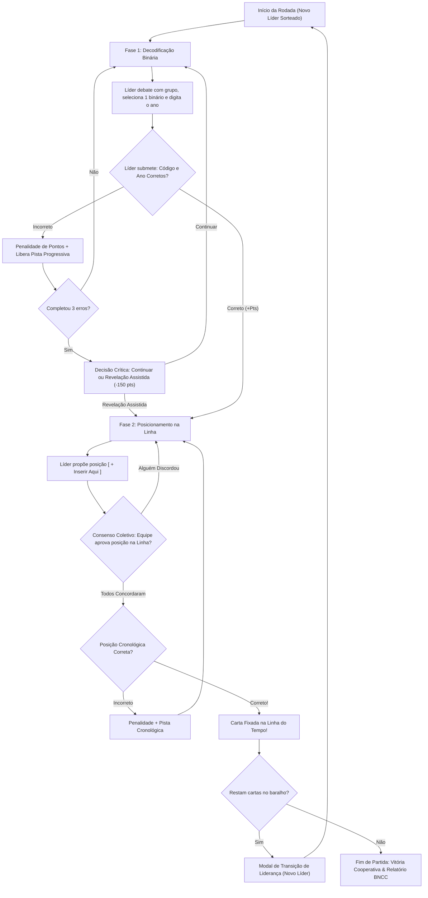

# 🎮 História em Bits — Manual Completo de Regras e Funcionamento

> **Componentes Curriculares:** História & Pensamento Computacional (Lógica Binária)  
> **Público-Alvo:** 1º ano do Ensino Médio (15 a 16 anos)  
> **Habilidades BNCC:** `EM13CHS103` (Argumentação histórica, causalidade e cronologia) e `EM13CO13` (Representação digital de dados e sistema binário)  
> **Tema Base:** Era das Revoluções e Formação do Mundo Contemporâneo (Séculos XVIII e XIX)  
> **Autoras do Design Pedagógico:** Andresa Fernandes, Fernanda Abreu, Pâmela Amorim  

---

## 1. Visão Geral do Jogo

O **História em Bits** é um jogo cooperativo e pedagógico no qual os participantes assumem o papel de uma equipe de investigação histórica e digital. O objetivo central é **reconstruir a Linha do Tempo da Era das Revoluções**, decodificando anos históricos expressos na linguagem fundamental da computação: o **código binário de 11 bits**.

A partida parte de uma **Carta Central Inicial de Referência** (*Independência do Brasil, 1822*), cuja data serve de âncora cronológica, e desafia os jogadores a posicionar corretamente as cartas sorteadas do baralho.

Para alcançar a vitória coletiva, a equipe não pode depender de suposições isoladas: o jogo exige **trabalho em equipe**, **conversão matemática rigorosa por potências de 2**, **dupla validação por consenso coletivo** e **argumentação cronológica fundamentada**.

---

## 2. Modos e Formatos de Jogo

O aplicativo oferece flexibilidade para se adaptar a diferentes realidades de infraestrutura escolar:

### 2.1. Multiplayer em Rede Local (Wi-Fi / Hotspot Celular)
* **Jogadores por sala:** 2 a 5 participantes conectados simultaneamente.
* **Capacidade do servidor:** Até 5 salas ativas independentes (`SALA-01` a `SALA-05`).
* **Conectividade sem dependência de internet externa:**
  * **Via Roteador da Escola / Laboratório:** Todos conectam no mesmo Wi-Fi local.
  * **Via Ponto de Acesso / Hotspot Móvel:** Um estudante ou professor ativa o *Roteador Wi-Fi* do próprio celular (sem necessidade de gastar pacote de dados 4G). Os colegas se conectam a esse sinal.
* **Facilidades de Conexão:**
  * **Detecção Automática de Servidor:** Na tela de entrada, o botão *🔍 Detectar Servidor na Rede* varre a rede local e localiza automaticamente o servidor do jogo.
  * **Código Padronizado:** Entradas de código (`SALA-01`, etc.) com conversão automática para maiúsculas e autocorreção desativada.
* **Dinâmica:** Cada participante interage a partir do seu próprio aparelho com sincronização em tempo real via WebSockets (Socket.io).

### 2.2. Partida Local (Mesa Única / Aparelho Compartilhado)
Ideal quando há apenas um celular, tablet ou computador disponível para a equipe ou em momentos de estudo individual:

* **👥 Modo Coletivo (Mesa Única / Passa ou Joga):**
  * Desenvolvido para equipes reunidas em torno de um único aparelho.
  * Partida completa com **10 cartas** do baralho (+ 1 central).
  * Inclui etapas formais de **Debate Coletivo e Consenso**, exigindo a concordância verbal de todo o grupo antes de enviar qualquer palpite ou posicionamento.
* **👤 Modo Individual (Treino Solo Autônomo):**
  * Voltado para treino individual, lição de casa ou reforço pedagógico.
  * **Seletor de Quantidade de Cartas:** O estudante pode escolher solucionar **4, 6, 8 ou 10 cartas** (+ 1 central inicial).
  * Fluxo direto e ágil: suprime modais de votação de consenso e telas de transição de liderança, permitindo raciocínio e cálculo dinâmicos no próprio ritmo do aluno.

---

## 3. Papéis na Partida e Liderança Rotativa

Para assegurar que todos os alunos participem ativamente e evitar a monopolização das decisões, a liderança é **estritamente rotativa a cada carta concluída na Linha do Tempo**:

| Papel | Quem Exerce | O Que Faz | Limitações e Responsabilidades |
| :--- | :--- | :--- | :--- |
| 👑 **Líder da Rodada** | 1 jogador por vez (alterna a cada carta fixada) | • Selecionar 1 dos 3 códigos binários da carta<br>• Digitar o ano decimal convertido<br>• Propor a verificação do ano para aprovação da equipe<br>• Propor o ponto de inserção na Linha do Tempo<br>• Escolher a Decisão Crítica no 3º erro | Não joga de forma isolada; tem o dever de consultar os colegas antes de submeter qualquer proposta. |
| 👥 **Integrantes da Equipe** | Demais alunos conectados na sala | • Acompanhar a carta e as opções selecionadas em tempo real<br>• Consultar a Tabela $2^n$ no botão de ajuda<br>• Realizar cálculos no rascunho e sugerir o ano<br>• Argumentar relações de causa e efeito histórico<br>• **Votar no Consenso Coletivo** (aceitar ou recusar propostas) | Os campos de texto e submissão direta ficam bloqueados (*modo espectador ativo*). |

### 🔔 Alerta Visual de Transição de Liderança
Sempre que uma carta é fixada com sucesso na Linha do Tempo, o sistema dispara um **Modal de Transição de Liderança** em tela cheia para todos os participantes:
* **Para o novo Líder:** Exibe a insígnia da coroa 👑, alertando que os controles da rodada passaram para ele e instruindo-o a dialogar com os colegas.
* **Para os demais membros:** Informa quem é o colega que assumiu a liderança 👥 e reforça a missão do grupo: abrir o Guia $2^n$, realizar os cálculos e orientar o líder verbalmente.

---

## 4. O Sistema de Consenso Coletivo na Linha do Tempo

O jogo foi desenhado para equilibrar fluidez de jogabilidade e debate cooperativo pedagógico:

1. **Decodificação Dinâmica (Fase 1):** O Líder da rodada seleciona a opção binária e digita o ano decimal correspondente. Os colegas acompanham a opção selecionada em tempo real em seus aparelhos e debatem verbalmente na sala de aula realizando os cálculos na Tabela $2^n$. Para manter o ritmo da aula, o Líder clica em **Verificar Ano** diretamente (sem interrupções de modais a cada tentativa).
2. **Consenso Coletivo Cronológico (Fase 2):** Ao avançar para a Linha do Tempo, a equipe precisa tomar uma decisão estratégica conjunta. Quando o Líder clica em `[ + Inserir Aqui ]`, o sistema abre o painel de **Consenso da Equipe** para todos os participantes:
   * **Contextualização Histórica Clara:** O modal informa exatamente a relação temporal proposta (ex.: *Inserir entre "Declaração de Independência dos EUA" e "Independência do Brasil"* ou *no início da Linha do Tempo*), permitindo que todos os colegas compreendam e argumentem sobre a ordem cronológica.
   * **Votação dos Jogadores Ativos:** Cada integrante vota `✅ Concordar` ou `❌ Discordar`. Apenas jogadores conectados na sala são contabilizados, impedindo travamentos caso alguém sofra oscilação momentânea de sinal.
   * **100% de Aprovação:** Quando todos os participantes ativos aceitam, o sistema valida a posição cronológica. Se alguém discordar, a proposta é cancelada para que a equipe revise a ordem dos acontecimentos.

*(Nota: Em partidas individuais ou com apenas 1 jogador conectado, a validação cronológica é imediata).*

---

## 5. Pontuação, Economia Coletiva e Penalidades

A equipe inicia a partida com um saldo de **1000 pontos**. Os pontos medem a precisão histórica e o equilíbrio operacional do grupo.

### 5.1. Bônus de Decodificação Binária
Ao acertar o código binário e a conversão decimal:
* **Acerto na 1ª tentativa:** `+100 pontos` (Bônus máximo de precisão).
* **Acerto na 2ª tentativa:** `+50 pontos`.
* **Acerto na 3ª tentativa ou mais:** `+25 pontos`.

### 5.2. Penalidades e Pistas na Decodificação
Erros no código ou no cálculo decimal geram penalidades e liberam pistas progressivas:
* **1º Erro:** `-50 pontos` $\rightarrow$ Libera a **Dica 1** (*Contexto Histórico / Século / Relação temporal*).
* **2º Erro:** `-50 pontos` $\rightarrow$ Libera a **Dica 2** (*Pista Matemática / Eliminação de distrator binário explícito*).
* **3º Erro:** `-50 pontos` $\rightarrow$ Libera a **Dica 3** (*Pista Específica Final*) e abre a **Decisão Crítica da Equipe**.
* **Erros subsequentes (após a 3ª tentativa):** `-25 pontos` cada.

### 5.3. Penalidades e Pistas na Linha do Tempo
Erros de ordenação cronológica:
* **1º Erro de posição:** `-25 pontos` $\rightarrow$ Libera pista de direção (*"Mova mais para a esquerda/passado ou direita/futuro"*).
* **2º Erro de posição:** `-50 pontos` $\rightarrow$ Libera pista de intervalo (*"Aconteceu entre o Evento X e o Evento Y"*).
* **3º Erro de posição:** `-50 pontos` $\rightarrow$ Abre a **Decisão Crítica da Linha do Tempo**.
* **Erros subsequentes na linha:** `-25 pontos` cada.

### 5.4. Decisões Críticas (3º Erro) e Recursos Pagos
Ao atingir o 3º erro em qualquer fase, a equipe é colocada diante de uma escolha estratégica:
1. **Continuar Tentando:** Gratuito. A equipe mantém o controle da resolução usando todas as dicas desbloqueadas. Novos erros passam a custar apenas `-25 pontos`.
2. **Revelação Assistida (Decodificação):** Custa `150 pontos`. Revela o ano correto e avança a carta para a Linha do Tempo.
3. **Posicionamento Assistido (Linha do Tempo):** Custa `150 pontos`. Encaixa a carta na posição cronológica correta automaticamente.
4. **Revelar Ano Oculto da Linha do Tempo:** Custa `50 pontos`. Revela o ano decimal de qualquer carta já fixada na linha para servir de marco cronológico de apoio.

---

## 6. Fluxo Completo de uma Rodada



---

## 7. Desafio de Resgate e Reserva de Emergência

Se o saldo da equipe atingir **0 pontos**, o sistema entra em estado de pane e dispara o **Desafio de Resgate (Reinicialização Binária)**:

```
                  Pontuação Coletiva atinge 0
                             │
                             ▼
               [ Desafio de Resgate Ativado ]
           Código de 8 bits gerado (ex: 01011010)
                             │
            ┌────────────────┴────────────────┐
            ▼                                 ▼
   [ ACERTO DO CÓDIGO ]             [ FALHA NO CÓDIGO ]
  Recupera +150 pontos!             Entra em Reserva de Emergência:
  A equipe volta ao jogo             • Pontuação congelada em 0
  com economia recuperada.           • Recursos pagos bloqueados
                                     • O PRÓXIMO ERRO ENCERRA A PARTIDA (Game Over)!
```

* Se a equipe estiver na **Reserva de Emergência** e cometer qualquer erro (na decodificação ou na cronologia), ocorre **Game Over imediato**.

---

## 8. Lógica da Conversão Binária (Tabela $2^n$)

O jogo utiliza números binários de **11 bits** para os anos históricos (valores decimais de 0 a 2047) e de **8 bits** no Desafio de Resgate (0 a 255).

### Tabela de Potências de Base 2 (11 Bits):
| Bit | $b_{10}$ | $b_9$ | $b_8$ | $b_7$ | $b_6$ | $b_5$ | $b_4$ | $b_3$ | $b_2$ | $b_1$ | $b_0$ |
| :--- | :---: | :---: | :---: | :---: | :---: | :---: | :---: | :---: | :---: | :---: | :---: |
| **Potência** | $2^{10}$ | $2^9$ | $2^8$ | $2^7$ | $2^6$ | $2^5$ | $2^4$ | $2^3$ | $2^2$ | $2^1$ | $2^0$ |
| **Valor Decimal** | **1024** | **512** | **256** | **128** | **64** | **32** | **16** | **8** | **4** | **2** | **1** |

### Regra Algorítmica de Conversão:
Para converter o código binário para o ano decimal, **soma-se o valor decimal correspondente apenas às colunas cujo bit seja igual a `1`**. Colunas com bit `0` não entram na soma.

$$\text{Ano Decimal} = \sum_{i=0}^{n-1} b_i \cdot 2^i$$

#### Exemplo 1 — Queda da Bastilha (Ano 1789):
* **Binário:** `11011111101`
* **Decomposição:**
  $$1024 + 512 + 0 + 128 + 64 + 32 + 16 + 8 + 4 + 0 + 1 = 1789$$

#### Exemplo 2 — Independência do Brasil (Ano 1822):
* **Binário:** `11100011110`
* **Decomposição:**
  $$1024 + 512 + 256 + 0 + 0 + 0 + 16 + 8 + 4 + 2 + 0 = 1822$$

> **Recurso em Partida:** Qualquer participante pode tocar a qualquer momento no botão **Guia $2^n$** no topo da tela para abrir a tabela interativa sem perder pontos.

---

## 9. Catálogo de Cartas do Baralho Histórico

O baralho é composto por **1 Carta Central Inicial Fixa** e **10 Cartas de Eventos** fundamentais dos séculos XVIII e XIX:

| ID | Evento Histórico | Ano Decimal | Código Binário (11 bits) | Papel no Jogo |
| :---: | :--- | :---: | :---: | :--- |
| `card_00` | **Independência do Brasil** | 1822 | `11100011110` | **Carta Central Inicial** (Âncora cronológica fixa) |
| `card_01` | **Queda da Bastilha (Revolução Francesa)** | 1789 | `11011111101` | Carta do Baralho |
| `card_02` | **Declaração de Independência dos EUA** | 1776 | `11011110000` | Carta do Baralho |
| `card_03` | **Máquina a Vapor de James Watt** | 1769 | `11011101001` | Carta do Baralho |
| `card_04` | **Início da Revolução Haitiana** | 1791 | `11011111111` | Carta do Baralho |
| `card_05` | **Chegada da Família Real ao Brasil** | 1808 | `11100010000` | Carta do Baralho |
| `card_06` | **Congresso de Viena** | 1814 | `11100010110` | Carta do Baralho |
| `card_07` | **Batalha de Waterloo (Derrota de Napoleão)** | 1815 | `11100010111` | Carta do Baralho |
| `card_08` | **Confederação do Equador** | 1824 | `11100100000` | Carta do Baralho |
| `card_09` | **Publicação do Manifesto Comunista** | 1848 | `11100111000` | Carta do Baralho |
| `card_10` | **Proclamação da República no Brasil** | 1889 | `11101100001` | Carta do Baralho |

---

## 10. Área do Professor e Avaliação Pedagógica (BNCC)

O acesso ao Painel Docente é realizado através do botão de cadeado na tela inicial utilizando a senha mestre `PROF2026`.

### 10.1. Evidências de Aprendizagem Mapeadas:
1. **Habilidade `EM13CHS103` (Cronologia e Relações de Causa e Efeito):**
   * Taxa percentual de acerto cronológico na Linha do Tempo.
   * Total de erros de ordenação temporal e necessidade de pistas cronológicas.
   * Identificação de marcos históricos anteriores e posteriores.
2. **Habilidade `EM13CO13` (Pensamento Computacional e Lógica Binária):**
   * Percentual de decodificação correta na primeira tentativa.
   * Quantidade de dicas matemáticas solicitadas.
   * Desempenho no cálculo sob pressão no Desafio de Resgate de 8 bits.
3. **Competências Socioemocionais e Trabalho em Equipe:**
   * Índice de consenso (propostas rejeitadas que geraram novo debate produtivo).
   * Rotação e engajamento equilibrado de liderança entre os participantes.

### 10.2. Gestão Docente em Tempo Real:
* Monitoramento de todas as salas ativas (`SALA-01` a `SALA-05`), pontuação e rodada atual.
* Opção de reiniciar ou resetar salas remotamente.
* Tolerância de rede de **120 segundos** para quedas momentâneas de sinal Wi-Fi sem perda do progresso dos estudantes.

---

## 11. Guia Rápido dos Estudantes (Passo a Passo)

1. **Analise a Carta:** Observe o título, a imagem de época e o resumo histórico.
2. **Debata com a Equipe:** Identifiquem juntos em que década ou século aquele evento ocorreu.
3. **Abra o Guia $2^n$:** Calculem a soma dos valores onde os bits são `1`.
4. **Submissão com Consenso 1:** O Líder escolhe a opção, digita o ano e solicita a aprovação de todos na tela.
5. **Posicione na Linha do Tempo:** Encaixem o evento no ponto cronológico adequado em relação às cartas anteriores.
6. **Consenso 2:** Todos devem votar `✅ Concordar` no aparelho para confirmar o posicionamento.
7. **Monitore a Pontuação:** Cuidado com os erros consecutivos para não ativar o Desafio de Resgate!
8. **Passe a Liderança:** A cada carta fixada, um novo líder assume o comando da rodada!
